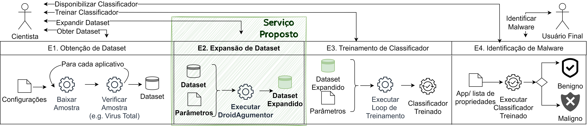
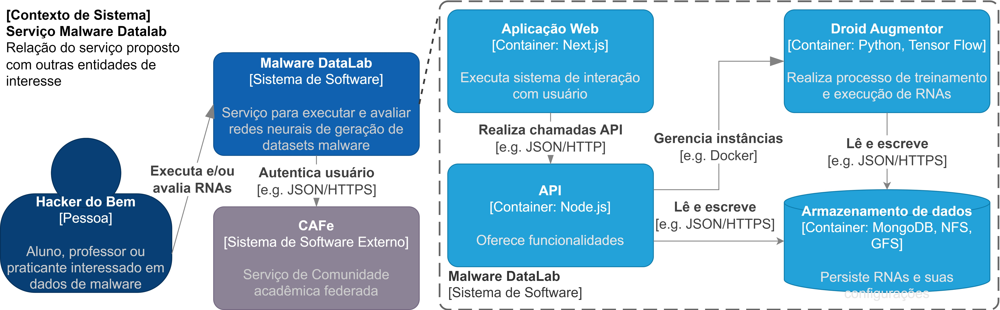
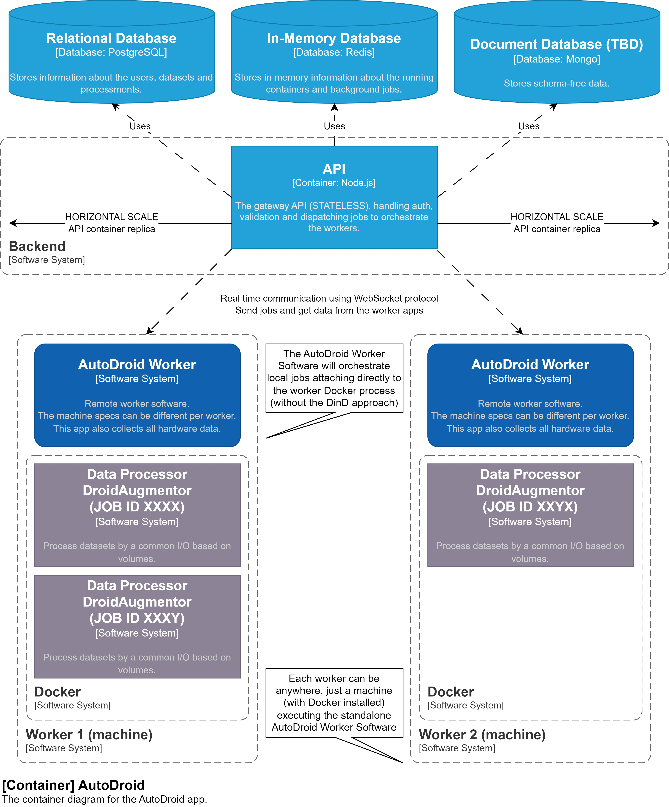
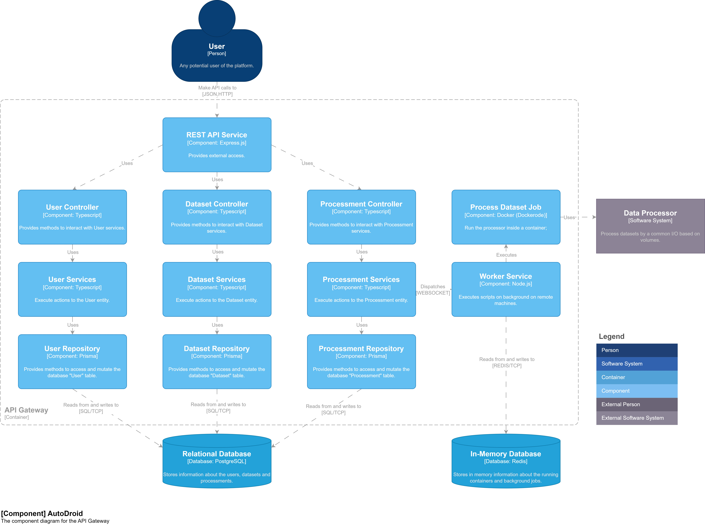
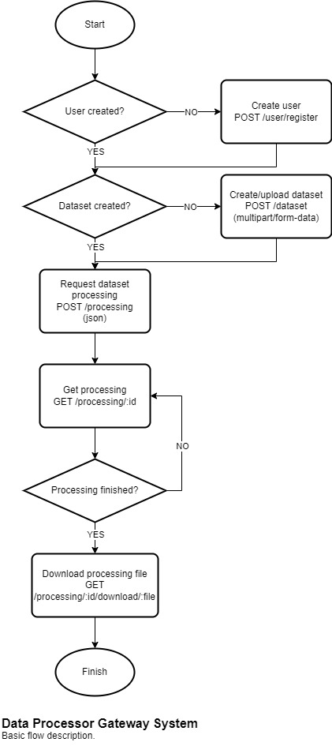

<p align="center">
  
</p>

<h3 align="center">AutoDroid</h3>

<div align="center">


</div>

Este repositório tem o código da API da AutoDroid, com REST, GraphQL e um servidor MCP. O cliente de linha de comando e o SDK ficam no repositório [autodroid-sdk](https://github.com/MalwareDataLab/autodroid-sdk) (pacote [autodroid](https://www.npmjs.com/package/autodroid) no npm).

Outros documentos: [requisitos funcionais e não funcionais](https://docs.google.com/document/d/1tCNZw9VFt5honSpTOx_DjVQ7-l0qdYta), [configuração](docs/CONFIGURATION.md), [API](docs/API.md), [MCP](docs/MCP.md), [estrutura do código](docs/CODEBASE_STRUCTURE.md), [contribuições](docs/CONTRIBUTING.md) e [changelog](CHANGELOG.md).

## Sobre

Ferramentas de IA como a DroidAugmentor ajudam a detectar variações ("mutações") de malware, mas rodá-las à mão dá trabalho e não escala. A AutoDroid oferece essas ferramentas como serviço: o usuário envia um conjunto de dados, escolhe um processador e baixa o resultado.

O serviço cobre a etapa de expansão de dataset do pipeline de AutoML descrita em [DroidAugmentor](https://sol.sbc.org.br/index.php/sbseg_estendido/article/view/27273).





## Arquitetura

A API é escrita em TypeScript, com Node.js, Express e TypeGraphQL. Usa PostgreSQL (via Prisma), Redis (filas com Bull), MongoDB, Tsyringe para injeção de dependência e Vitest para testes. O código segue DDD e Clean Architecture, com os princípios SOLID, e os testes são escritos com TDD.

Diagramas no [modelo C4](https://c4model.com/):






Entidades:

- `User`: usuário da aplicação. Guarda email, nome e telefone. O login é feito pelo Firebase ou por SAML (RNP CAFe).
- `UserAuthProviderConn`: vínculo de um usuário com um provedor de autenticação.
- `File`: arquivo, como um dataset ou o resultado de um processamento.
- `Processor`: imagem Docker que processa um conjunto de dados com os parâmetros informados.
- `Dataset`: arquivo de entrada de um processador.
- `Processing`: pedido de processamento de um usuário. Guarda o ciclo de vida completo, com status e resultado.
- `Worker`: instância da aplicação Worker, que executa os jobs em segundo plano.
- `WorkerRegistrationToken`: token que um administrador cria para registrar workers.
- `McpAuthorizationGrant`: autorização que um usuário dá a um cliente MCP, com uma linha por usuário, cliente e recurso.

## Requisitos

Servidor:

- Linux (macOS e Windows são experimentais)
- Virtualização habilitada na BIOS
- 4 GB de RAM
- 10 GB de disco livre, mais conforme os processadores usados (arquivos, resultados, banco de dados e imagens Docker)
- [Git](https://git-scm.com/downloads) e [Docker](https://docs.docker.com/get-docker/)

Usuário: um navegador ou um cliente de API (curl, httpie, Postman, Insomnia).

## Como executar

Antes de tudo, siga a [configuração](docs/CONFIGURATION.md) para obter as credenciais do Firebase e do Google Cloud Storage e preencha as variáveis obrigatórias no `docker-compose.yml`. Sem `SESSION_SECRET` e `MCP_OAUTH_CLIENT_ID_SECRET`, a API não sobe.

```bash
git clone https://github.com/MalwareDataLab/AutoDroid.git
cd AutoDroid
docker compose up --build
```

A primeira inicialização pode levar alguns minutos. Deixe o terminal aberto. Quando der certo, o console mostra algo assim:

```bash
autodroid_api_gateway_prod  | 🆗 Database connection success.
autodroid_api_gateway_prod  | 🆗 Redis default connection success.
autodroid_api_gateway_prod  | 🆗 Non-relational Database connection success.
autodroid_api_gateway_prod  | 🆗 Firebase authentication provider init success.
autodroid_api_gateway_prod  | 🆗 Google storage provider init success.
autodroid_api_gateway_prod  | 🆗 Processing background jobs on autodroid-api.
autodroid_api_gateway_prod  | ⚡️ autodroid-api development version X using Node.js X running at port 3333 with PID X.
```

Para parar, use `Ctrl + C` ou `docker compose down`. A pasta `./.runtime` guarda os arquivos da aplicação e pode exigir permissão de superusuário para ser alterada ou apagada.

Para rodar sem Docker, veja a [instalação manual](docs/MANUAL_SETUP.md).

## Uso

A API responde em http://localhost:3333 (REST) e http://localhost:3333/graphql (GraphQL). As rotas estão em [docs/API.md](docs/API.md), e há uma [coleção do Postman](https://www.postman.com/luizfelipelaviola/workspace/autodroid/collection/17242387-d69ee1f8-a603-4ac8-89aa-787cfacffaee?action=share&creator=17242387&active-environment=17242387-9dcb7b8e-4eb1-4a10-b607-74725449575f) com todas as rotas, queries e mutations. O script `./demo.sh` faz uma demonstração completa, depois da configuração.

O fluxo comum:

1. Toda requisição leva o header `Authorization: Bearer ${token}`, com o token do Firebase.
2. Um administrador registra um processador (imagem Docker).
3. O usuário cria um dataset. A API devolve a `upload_url` do campo `file`, e o arquivo é enviado para ela. Há um [dataset de exemplo](./docs/samples/dataset_example.csv).
4. Com o `processor_id` e o `dataset_id`, o usuário pede o processamento, com os parâmetros padrão ou personalizados.
5. Quando o `status` indica que terminou, o resultado (um zip) é baixado pela `public_url` do campo `result_file`.

O worker é uma aplicação separada, que executa os jobs em segundo plano. Um administrador cria um `WorkerRegistrationToken`, e o campo `token` autentica o worker na API. A instalação está em [autodroid-worker](https://github.com/MalwareDataLab/autodroid-worker).

<p align="center">
  
</p>

Os mesmos recursos também estão disponíveis por MCP, para qualquer cliente MCP. Os dois modos de uso estão em [docs/MCP.md](docs/MCP.md).

## Testes

```bash
yarn test
```

Roda as camadas unitária, de integração e e2e. As duas últimas sobem bancos e um emulador de storage em contêineres, então o Docker precisa estar rodando. Elas também entram no Firebase com contas de teste: copie `packages/api/.env.test.example` para `packages/api/.env.test` e preencha `TESTING_FIREBASE_WEB_API_KEY`, `TESTING_ADMIN_*` e `TESTING_USER_*`. A camada e2e usa o Chromium do Playwright (`yarn workspace autodroid-api run playwright install --with-deps chromium`). Os relatórios de cobertura ficam em `packages/api/test/outputs`.

Cada camada roda sozinha com `yarn workspace autodroid-api run test:unit`, `test:integration` ou `test:e2e`. O que cada camada simula e as metas de cobertura estão no [AGENTS.md](AGENTS.md).

A camada `test:external` usa serviços reais (Google Cloud Storage e Firebase) e não roda por padrão:

```bash
yarn workspace autodroid-api run test:external
```

O comando `yarn lint` checa o lint e os tipos e corrige o que for possível. Os testes do CLI estão no repositório [autodroid-sdk](https://github.com/MalwareDataLab/autodroid-sdk).

## CI e releases

O workflow `ci.yml` roda em pull requests e pushes para `main` e `qa`: lint, build, build da imagem Docker (sem publicar) e testes. O workflow `deploy.yml` roda em pushes para `main`, `staging` e `qa`: o release-please abre o PR de release e, quando não há PR de release aberto, a imagem Docker é construída e publicada no Docker Hub e a release é criada. Depois, o job `sync-develop` atualiza o `develop`.

## Implantação

Com a [configuração](docs/CONFIGURATION.md) pronta, preencha as variáveis no `docker-compose.yml`, troque `NODE_ENV=development` por `NODE_ENV=production` (só assim valem o CORS restrito, o cookie de sessão seguro e a checagem de origem do `/mcp`) e rode:

```bash
docker compose build --no-cache
docker compose up -d
```

A aplicação usa a porta 3333. Para mudar, troque o lado do host em `ports` (por exemplo `8080:3333`) no `docker-compose.yml` e rode `docker compose up -d`. Libere a porta no firewall e verifique as restrições da sua rede e do seu provedor.

O `docker-compose.yml` inclui o [watchtower](https://containrrr.dev/watchtower/), que atualiza a aplicação sozinho. Para atualizar à mão:

```bash
docker compose down
docker compose pull
docker compose up -d
```

## Problemas comuns

Se a aplicação não inicia:

- Confira os [requisitos](#requisitos) e a [configuração](docs/CONFIGURATION.md).
- Teste o Docker com `docker run --rm hello-world:latest`. Se faltar permissão, siga a [pós-instalação do Docker](https://docs.docker.com/engine/install/linux-postinstall/).
- Reconstrua a imagem com `docker compose build --no-cache`. Se der erro, envie a mensagem ao mantenedor.

Para limpar o ambiente do projeto (isto apaga o banco de dados):

```bash
docker compose down
sudo rm -rf ./.runtime
docker rmi malwaredatalab/autodroid-api:latest
```

## Referências

LAVIOLA, Luiz Felipe; PAIM, Kayuã Oleques; KREUTZ, Diego; MANSILHA, Rodrigo Brandão. AutoDroid: disponibilizando a ferramenta DroidAugmentor como serviço. In: ESCOLA REGIONAL DE REDES DE COMPUTADORES (ERRC), 20. , 2023, Porto Alegre/RS. Anais [...]. Porto Alegre: Sociedade Brasileira de Computação, 2023 . p. 145-150. DOI: https://doi.org/10.5753/errc.2023.929.

LAVIOLA, Luiz Felipe; GASPAR DINIZ NOGUEIRA, Angelo; KREUTZ, Diego; BRANDÃO MANSILHA, Rodrigo. Cloud AutoDroid: uma Arquitetura de Backend para Executar Serviços de IA Generativa na Nuvem. In: ESCOLA REGIONAL DE ENGENHARIA DE SOFTWARE (ERES), 8. , 2024, Santiago/RS. Anais [...]. Porto Alegre: Sociedade Brasileira de Computação, 2024 . p. 258-267. DOI: https://doi.org/10.5753/eres.2024.4302.

CASOLA, Karina; PAIM, Kayuã Oleques; MANSILHA, Rodrigo Brandão; KREUTZ, Diego. DroidAugmentor: uma ferramenta de treinamento e avaliação de cGANs para geração de dados sintéticos. In: SALÃO DE FERRAMENTAS - SIMPÓSIO BRASILEIRO DE SEGURANÇA DA INFORMAÇÃO E DE SISTEMAS COMPUTACIONAIS (SBSEG), 23. , 2023, Juiz de Fora/MG. Anais [...]. Porto Alegre: Sociedade Brasileira de Computação, 2023 . p. 57-64. DOI: https://doi.org/10.5753/sbseg_estendido.2023.235793.

NOGUEIRA, Angelo Gaspar Diniz; PAIM, Kayua Oleques; BRAGANÇA, Hendrio; MANSILHA, Rodrigo; KREUTZ, Diego. MalSynGen: redes neurais artificiais na geração de dados tabulares sintéticos para detecção de malware. In: SALÃO DE FERRAMENTAS - SIMPÓSIO BRASILEIRO DE SEGURANÇA DA INFORMAÇÃO E DE SISTEMAS COMPUTACIONAIS (SBSEG), 24. , 2024, São José dos Campos/SP. Anais [...]. Porto Alegre: Sociedade Brasileira de Computação, 2024 . p. 129-136. DOI: https://doi.org/10.5753/sbseg_estendido.2024.243359.
